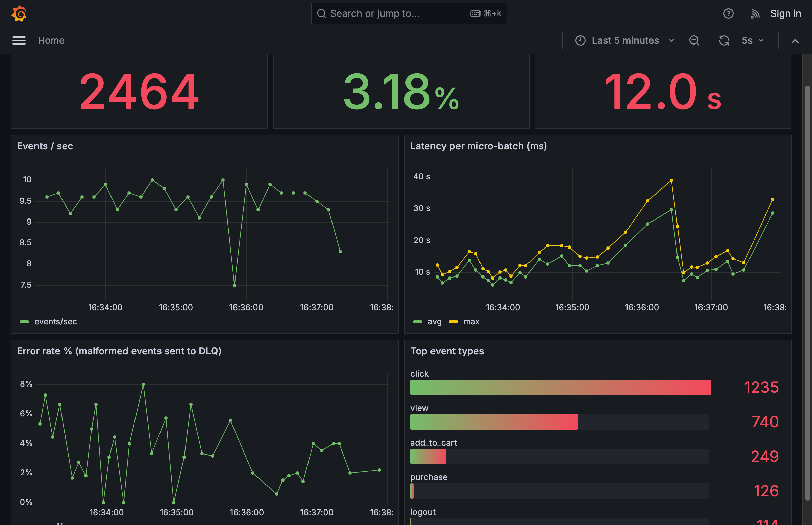
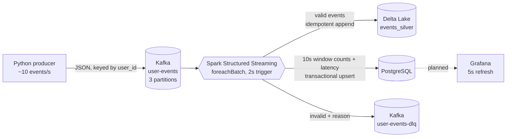

# Real-Time Event Streaming Pipeline

A streaming data pipeline built end to end: a Python producer publishes clickstream events to **Kafka**, **Spark Structured Streaming** validates them in micro-batches, and the results go to **Delta Lake** (clean events), **PostgreSQL** (aggregates and latency metrics) and a **dead-letter topic** (rejected events). Everything runs locally with Docker Compose.

> Status: core pipeline working. Grafana dashboard, tests and CI are in progress (see [Roadmap](#roadmap)).



## Architecture



## How it works

1. **Produce.** `event_producer.py` generates JSON events (click, view, purchase, add_to_cart, logout) every 0.5 s. About 3% are deliberately malformed to exercise the error path. Events are keyed by `user_id`, so one user's events stay ordered within a partition.
2. **Buffer.** Kafka stores events in the `user-events` topic (3 partitions). Producer and consumer are decoupled: if Spark is down, events wait in Kafka.
3. **Process.** Every 2 seconds Spark reads the new slice of the topic and validates each event against a schema and business rules (known event type, positive user id, valid timestamp).
4. **Route.** For each micro-batch:
   - valid events are appended to a **Delta Lake** table;
   - invalid events are written to **`user-events-dlq`** with the original payload, a reason code and the source partition/offset;
   - valid events are grouped into 10-second windows by event type, and the counts plus latency stats are upserted into **PostgreSQL**.
5. **Recover.** Spark checkpoints its progress. After a crash it resumes from the last finished batch.

## Design decisions

- **`foreachBatch` instead of append-mode windowed aggregation.** Append mode emits a window only after its watermark passes, which delays results by at least the window length. Here each micro-batch computes partial window counts and adds them into Postgres, so results appear every trigger.
- **Replays can't corrupt data.** Spark gives at-least-once delivery, so a crash can re-run a batch. Delta writes use `txnAppId`/`txnVersion`, so a replayed batch is skipped. Postgres writes record the `batch_id` in the same transaction as the aggregate upsert (`batch_metrics` is the ledger), so a replayed batch changes nothing. The dead-letter topic is at-least-once: duplicates are possible after a crash, and that trade-off is deliberate.
- **Dead-letter topic with context.** Each rejected record keeps the raw text, a reason, and where it came from, so it can be inspected and replayed.
- **Measurable latency.** Each event carries its creation time, and Spark records `now - event_time` per batch (average and max). That is the real end-to-end figure.
- **Counts are added on conflict.** A 10-second window spans several 2-second batches, and each batch only sees part of it.
- **Kafka in KRaft mode.** No Zookeeper container is needed with Kafka 3.8.
- **`spark.sql.shuffle.partitions=3`.** The default of 200 adds overhead to tiny micro-batches.
- **Validation logic is separate** (`transforms.py`, no I/O), so it can be unit-tested without Kafka.

## Quick start

Requirements: Docker Desktop (or Docker Engine with Compose v2) with at least 4 CPUs and 6 GB RAM allocated. Internet is needed on the first run, when Spark downloads its Kafka and Delta jars (cached in `.ivy-cache/` afterwards).

```bash
git clone https://github.com/<your-username>/streaming-pipeline.git
cd streaming-pipeline
docker compose up -d --build
docker compose ps                      # wait until kafka and postgres are healthy
docker compose logs -f spark | grep batch
```

You should see lines like `batch 312: valid=20 invalid=1 avg_latency_ms=2431`.

Stop everything with `docker compose down`. To wipe all state (Kafka, Postgres, checkpoints and the Delta table), use `docker compose down -v` and delete `.ivy-cache/` only if you want to re-download jars.

## Verify it works

**Rejected events in the dead-letter topic**
```bash
docker compose exec kafka /opt/kafka/bin/kafka-console-consumer.sh \
  --bootstrap-server kafka:9092 --topic user-events-dlq --from-beginning --max-messages 5 --timeout-ms 10000
```

**Aggregates and latency in Postgres**
```bash
docker compose exec postgres psql -U pipeline -d events_db -c \
  "SELECT * FROM event_agg ORDER BY window_start DESC, event_type LIMIT 10;"
docker compose exec postgres psql -U pipeline -d events_db -c \
  "SELECT batch_id, valid_count, invalid_count, round(avg_latency_ms) AS avg_ms FROM batch_metrics ORDER BY batch_id DESC LIMIT 5;"
```

**Delta Lake table**
```bash
docker compose exec spark sh -c 'ls /data/delta/events_silver/_delta_log | tail -5'
docker compose run --rm --no-deps spark /opt/spark/bin/spark-submit --master 'local[1]' \
  --conf spark.jars.ivy=/tmp/.ivy --packages io.delta:delta-spark_2.12:3.2.0 \
  /app/check_delta.py 2>/dev/null
```

## Repository layout

| Path | Purpose |
|---|---|
| `docker-compose.yml` | Defines all services: Kafka (KRaft), topic creation job, Postgres, producer, Spark. Declares the `spark-data` volume for checkpoints and the Delta table. |
| `producer/event_producer.py` | Generates events and publishes them to Kafka. Idempotent producer, keyed by `user_id`, injects malformed events at `BAD_EVENT_RATE`. |
| `producer/Dockerfile`, `requirements.txt` | Builds the producer image. |
| `sql/init.sql` | Creates `event_agg` (window counts) and `batch_metrics` (per-batch stats, also the idempotency ledger) on first Postgres start. |
| `spark_job/transforms.py` | Event schema and validation rules (pure DataFrame logic, no I/O). |
| `spark_job/streaming_job.py` | The streaming job: reads Kafka, validates, and writes to Delta, the dead-letter topic and Postgres. |
| `spark_job/check_delta.py` | Helper that reads the Delta table back for verification. Not part of the pipeline. |
| `spark_job/Dockerfile` | Builds the Spark image (official Spark image plus `psycopg2`). |
| `docs/architecture.md` | The architecture diagram on its own. |

## Data stores

| Store | Holds | Why |
|---|---|---|
| Kafka `user-events` | Raw events, temporarily | Transport and buffer |
| Kafka `user-events-dlq` | Rejected events with reason | Debugging and replay |
| Delta Lake `events_silver` | Every valid event | Long-term storage and reprocessing |
| Postgres `event_agg` | Counts per 10 s window and event type | Fast, small queries for dashboards |
| Postgres `batch_metrics` | Per-batch counts and latency | Dashboard metrics and replay safety |

## Configuration

Producer: `EVENTS_PER_TICK` (events per 0.5 s tick), `BAD_EVENT_RATE` (fraction of malformed events). Both are set in `docker-compose.yml`. The Spark trigger interval is set in `spark_job/streaming_job.py`.

## Roadmap

- [x] Kafka (KRaft) with automatic topic creation
- [x] Python producer with malformed-event injection
- [x] Spark Structured Streaming job with schema validation
- [x] Dead-letter topic with reason codes
- [x] Delta Lake sink with idempotent writes
- [x] PostgreSQL sink with transactional, idempotent upserts
- [ ] Grafana dashboard (events/sec, error rate, top event types, latency)
- [ ] Failure-recovery demo (kill Spark, restart, verify no loss or duplicates)
- [ ] Unit tests and CI (GitHub Actions)
- [ ] Benchmarks table (throughput, latency, recovery time)

## Limitations

- Single Kafka broker and Spark in `local[2]` mode: a demo topology, not a high-availability deployment.
- No schema registry; the schema lives in `transforms.py`.
- The 2-second trigger creates many small Delta files. A production setup would compact them (`OPTIMIZE`) or use a longer trigger.
- No retention policy on the Postgres tables.

## Benchmarks

To be filled in from real runs.

| Metric | Value |
|---|---|
| Throughput tested | _X events/s_ |
| Avg / max end-to-end latency | _X ms / Y ms_ |
| Recovery time after killing Spark | _X s_ |
| Hardware | _e.g. 4 CPU / 6 GB Docker_ |
